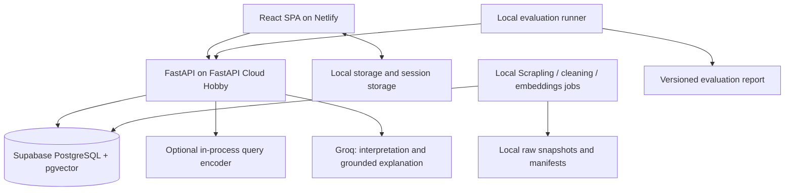

# Technical Implementation Plan

Status: M0 complete; M1 local foundation verified, hosted walking-skeleton gate pending owner publication/configuration. See [docs/progress.md](docs/progress.md) for measured evidence and remaining gates.

This plan implements [AGENTS.md](AGENTS.md) and records the decisions made during technical planning. The product brief governs scope; this document governs implementation order and proposed technical defaults. Items described as targets, candidates, or gates are not measured results. Keep both documents consistent when an approved requirement changes.

## 1. Build-agent instructions

1. Read both documents before coding. Inspect the current working tree and preserve existing user work.
2. Start with M0. Complete milestones in dependency order; do not mark a milestone complete without its evidence and acceptance checks. **After completing each milestone, report its results and stop; explicit user permission is required before starting the next milestone.** This includes its scaffolding, migrations and setup. M1 was already in progress when this rule was added; M2 requires permission after M1 completion.
3. Build a thin, usable discovery flow early. Expand it incrementally rather than implementing every layer in isolation.
4. Record progress in `docs/progress.md`: milestone, completed work, checks run, measured results, blockers, and next action. Never describe a proposed check as passed.
5. Resolve routine choices within the current milestone autonomously using current official documentation. Ask the user for permission to advance after milestone completion, or when changing scope, requiring paid services, or encountering a product tradeoff this plan does not resolve.
6. Pin compatible stable dependency versions and commit lockfiles when implementation begins. Do not copy versions from the legacy application indiscriminately.
7. Keep the legacy application and data intact while establishing the new application. Do not load untrusted pickle artifacts. Rebuild recommendation artifacts through the new pipeline.
8. Each milestone handoff must identify changed files, runnable commands, acceptance evidence, and outstanding limitations. Commit only when requested; document any missing hosting access that blocks deployment verification.
9. When credentials, secret keys, or hosting access are needed, notify the user at that point. Name the service, required configuration variables, and local/provider settings where they belong. Have the user configure secrets there rather than paste values into chat. Never commit or log secret values; report credential-dependent checks as blocked until configured.
10. **Before any frontend implementation, including scaffolding in M1, notify the user and wait for confirmation that their desired frontend skills are installed.** Inspect available skill descriptions and load relevant skills before proceeding. Independent backend/data tasks can continue while waiting.

## 2. Agreed decisions and scope

| Area | Decision |
| --- | --- |
| Goal | Portfolio-quality full-stack product with credible, evaluated AI/ML and genuine gamer usefulness |
| Main journey | Favorite games + natural-language request + explicit filters -> ranked shortlist -> grounded explanations -> conversational refinement |
| Persistence | Guest-only; browser-local preferences, saved games, feedback, limited recent history; active conversation retained for the current session |
| Accounts | No registration, Google sign-in, authentication flows, account profiles, or guest-to-account migration |
| Controls | Budget/free-only, Windows/macOS/Linux, preferred and unwanted genres/tags, play modes, explicit game exclusions |
| Region | US Steam store region; USD prices, with collection timestamps and recorded-price wording |
| Eligibility | Released standalone games, including free-to-play and clearly labeled Early Access |
| Exclusions | DLC, soundtracks, software, demos, unreleased games, adult-only sexual content; ordinary mature-rated games remain eligible |
| Visual direction | Premium, dark, image-rich, restrained accents, polished responsive and accessible interactions |
| Analytics | Supporting catalog exploration, not the homepage centerpiece |
| Scraping | Scrapling only; additional structured APIs/sources require investigation before selection |
| Budget | Free only, including hosting, database, inference, and required jobs |
| Availability | Publicly hosted with cold starts and bounded AI usage; useful discovery without hosted LLM inference |
| Local machine | Intel Core i5-5200U, 8 GB DDR3 RAM, no GPU |
| Delivery | Quality-based milestones; no fixed deadline |
| Evaluation | 30–50 curated requests, manual relevance judgments, one similarity baseline, constraint/grounding checks, latency report |

The initial acceptance scenario is: “I loved Hades for its combat and sense of progression. I want another satisfying single-player game, but with less repetition, playable on Windows, under $20.” This is a test scenario, not a statement about the user's personal history. Less repetition must not be presented as a verified attribute without supporting evidence.

## 3. Stack and deployment baseline

| Concern | Selected planning baseline | Notes |
| --- | --- | --- |
| Frontend | React, TypeScript, Vite | Static SPA; no additional frontend server |
| UI | Tailwind CSS, shadcn/ui | Custom visual system; semantic HTML and accessible interactions |
| Navigation/data | React Router, TanStack Query | Routing, bounded caching, request cancellation and mutations |
| Charts | Recharts | Focused analytics only |
| Backend | FastAPI, Pydantic, Uvicorn | Modular Python API with OpenAPI contracts |
| Database access | SQLAlchemy, Alembic, PostgreSQL driver | Explicit schema migrations and bounded connection pool |
| Database | Supabase-hosted PostgreSQL + pgvector | One database; no Supabase Auth requirement |
| Retrieval | pgvector + PostgreSQL full-text search | No separate hosted vector database or retained legacy FAISS dependency |
| Offline embeddings | Sentence Transformers | Compact 384-dimensional model; MiniLM is the initial candidate, subject to evaluation |
| Online embeddings | Compact ONNX runtime candidate | Must pass memory/latency/parity gate; do not assume full PyTorch fits the free API host |
| Ranking/evaluation | Explicit Python/NumPy; scikit-learn where useful | Understandable, versioned ranking; one reproducible baseline |
| LLM | Groq Free via a small provider adapter | Exact supported model selected at implementation; optional enhancement with bounded usage |
| Data jobs | Scrapling, Pandas, Pydantic | Local, resumable, low concurrency |
| Frontend host | Netlify Free | User-selected; configure SPA rewrites and provider subdomain |
| API host | FastAPI Cloud Hobby | Owner-selected replacement for Render on 2026-10-14; verify actual account/build/runtime limits in M1 |
| Checks | pytest, Vitest, React Testing Library, Playwright | Meaningful behavior checks and a small end-to-end suite |
| Tooling | uv for Python; npm for frontend; Ruff, ESLint, TypeScript | Stable pinned dependencies and documented PowerShell-compatible commands |
| CI | GitHub Actions | Bounded lint/type/test/build checks within free allowances |

No Redis, worker fleet, queue broker, microservices, paid monitoring, or mandatory local LLM. A plain provider adapter is sufficient; LangChain is not required for this flow.

### Free-service gates

The owner replaced Render with FastAPI Cloud on 2026-10-14. Current public-beta Hobby documentation reports $0, no credit card, 3 apps, 0.1 vCPU/512 MB shared and scale-to-zero. Configure minimum 0 / maximum 1 replica; future usage/build billing is not finalized and must be reviewed without assuming a paid budget. The pricing table and autoscaling guide disagree on the upper replica ceiling (2 versus 3); this app does not rely on that ceiling. Previously consulted Supabase Free documentation reported 500 MB database storage and pausing after one week of inactivity. Recheck actual account allowances before deployment. Verify Netlify's applicable plan, credits, transfer/request/build limits and exhaustion behavior; do not assume legacy quotas apply.

- Target API peak resident memory below 400 MB under representative low concurrency, preserving headroom. Measure startup as well as requests.
- Target hosted database use below 350 MB initially, including indexes and operational records. Measure a representative import and project catalog growth.
- Query embeddings must use the same model revision, normalization, and compatible representation as catalog embeddings. Validate ONNX conversion against the offline encoder.
- If ONNX inference cannot fit, record a decision before scaling: a verified free compatible inference service or a smaller evaluated model. Lexical fallback is useful degradation, not permission to silently drop semantic discovery from the completed product.
- Keep raw snapshots and large artifacts locally; keep operational database records bounded. Do not store game image binaries in the database.
- API cold starts and database pauses are different. Document database restoration; do not promise that a normal request resumes a paused Supabase project.
- Use free plans with paid auto-recharge/overage disabled where available; verify hard-stop behavior. Do not add artificial keep-alive traffic to evade provider limits.

## 4. Architecture and repository structure



Proposed layout (create during implementation):

```text
frontend/                 React SPA, generated API types, tests
backend/
  pyproject.toml
  uv.lock
  src/game_discovery/
    api/                  routes, dependencies, error mapping
    schemas/              request/response and normalized-data contracts
    catalog/              queries, eligibility, evidence, analytics
    retrieval/            vector and lexical retrieval, encoders
    ranking/              features, feedback adjustments, constraints
    ai/                   interpretation, explanation, provider adapter
    db/                   models, sessions, migrations integration
    jobs/                 audit, scrape, normalize, import, index
    evaluation/           runner, baseline, metrics
    core/                 configuration, logging, limits
  migrations/
  tests/
evaluation/               curated requests, judgments, report metadata
data/                     ignored raw/processed/artifact directories; small fixtures tracked
docs/                     architecture, operations, decisions, progress, reports
.github/workflows/        bounded CI
netlify.toml              frontend build and SPA rewrite configuration
IMPLEMENTATION_PLAN.md
AGENTS.md
```

Preserve root legacy files initially: `app.py`, both CSVs, `similarity_finale.pkl`, `faiss_index/`, and legacy dependencies. New environments must not depend on the legacy Streamlit application. Inspect `.streamlit/` for configuration without exposing secrets. Relocation or cleanup is a later explicit, documented change.

## 5. Catalog model and provenance

Use Steam app IDs as stable external identifiers. Titles are display/search fields, never primary identity keys. Deduplicate by verified identity rather than title alone. Quarantine ambiguous mappings instead of merging by guesswork.

Minimum schema:

| Entity | Key fields and purpose |
| --- | --- |
| `games` | app ID, title, normalized title, plain-text descriptions, type, release status/date, Early Access, eligibility status/reason, store URL, artwork URL, content hash, updated timestamp |
| `game_platforms` | game ID, platform, supported state; distinguish false from unknown |
| `taxonomy_terms` / `game_terms` | normalized genre/tag/play-mode identifiers and game associations; source labels retained |
| `game_prices` | game ID + US region + USD, amount in integer cents, free-to-play state, observed timestamp, source reference; current retained observation |
| `game_reviews` | positive/total counts and source summary where available, observed timestamp, source reference |
| `catalog_sources` / `game_evidence` | source URL, collection time, source field, supported value or excerpt, content hash; compact evidence for explanation validation |
| `game_embeddings` | game ID, artifact/model revision, content hash, vector, generated timestamp; one active model generation |
| `catalog_versions` / `job_runs` | active artifact manifest, counts, timestamps, status and bounded reports |
| `ai_usage_windows` | bounded global quota reservations for optional LLM use; no personal preference storage |

Store timestamps in UTC. Unknown values remain null/unknown, never false or zero by default. Historical imports with unknown observation dates must retain that uncertainty; import time is not collection time. Distinguish free-to-play from a temporary zero-price promotion.

Use ordinary indexes for identity/filter/join queries and a full-text index for descriptions/titles. Begin with exact vector search if measured fast enough. Add a pgvector approximate index only when justified by measured size and latency; validate filtered recall. An approximate search must not return disallowed games or silently underfill due to post-filtering.

Eligibility classifications require supporting source fields. Quarantine unclassified content from recommendations pending review. Keep recognizable but ineligible titles usable as favorite seeds only if clearly labeled and supported by usable metadata; never return them as eligible recommendations.

### Data workflow

1. Audit existing CSV headers, counts, duplicates, missingness, encoding, identifier coverage and provenance. Save a report; do not claim field coverage before inspection.
2. Probe a small sample of candidate structured sources and Scrapling pages. Document accessible fields, regional behavior, source terms, timestamps, failure modes and practical request rate. No additional source is selected by this plan.
3. Save raw snapshots with source, time, hash and run ID. Extract to a normalized schema and reject/quarantine invalid records with reasons.
4. Classify eligibility, normalize terms, validate region/currency and construct evidence records.
5. Generate embeddings from documented semantic text. Keep volatile prices/review counts out of semantic text so price refreshes do not trigger needless embedding work.
6. Batch-upsert validated records; generate embeddings only for changed semantic content/model revisions. Import staging data before promoting a complete artifact version.
7. Validate counts, foreign keys, vector dimensions, evidence references and constraints before atomic activation. Retain a rollback manifest locally.
8. Publish freshness summaries to the API. Refresh via documented manually invoked jobs initially; no guaranteed automated freshness schedule.

On the user's hardware: start with one browser session, conservative scraping concurrency, small embedding batches (initially 8–16, then measure), and sequential heavy jobs. Stream or chunk large files; never rebuild an N-by-N similarity matrix. Resume from checkpoints after interruption.

## 6. Recommendation behavior

### Request processing order

1. Validate bounded input, resolve seed game IDs, and load active catalog/artifact metadata.
2. Merge explicit request state with browser-local preferences. Current explicit controls override saved preferences.
3. If enabled, interpret natural language into a validated preference patch. An LLM may not silently override explicit controls. Conflicts require visible clarification; unambiguous additions appear as active filter chips.
4. Build the eligibility set using reliable hard constraints and exact exclusions.
5. Retrieve candidates using seed vectors, query vectors when available, and lexical matching. Filter during retrieval where possible and deterministically validate afterward.
6. Rank candidates using documented normalized features and feedback. Exclude seeds, explicitly excluded games, already-played games, and not-for-me titles from results by default.
7. Return a capped shortlist with rank features and catalog evidence available internally for debugging/evaluation.
8. Build template explanations immediately or use bounded LLM explanation generation. Validate claims and replace invalid output with templates.
9. Return applied constraints, unresolved preferences, evidence-backed reasons/tradeoffs, freshness, degradation state, and timing metadata.

### Hard-filter semantics

- Budget uses nonnegative integer USD cents. UI “maximum” is inclusive; natural-language “under” can be represented as exclusive. Unknown/non-USD/non-US prices fail a price constraint. Show recorded price and observation date; do not imply a live purchase quote.
- Free-only requires explicit supporting evidence of the chosen free eligibility policy.
- Platform controls expose whether the user means any selected platform or all selected platforms; default to any and document it. Unknown support does not pass a required platform.
- Required play modes must be explicitly supported. Preferred genres/tags boost rank; unwanted genres/tags are exclusions. Do not treat a genre preference as a mandatory filter unless the UI explicitly offers that meaning.
- Evidence absence is not evidence of absence: disclose incomplete tag coverage and use only supported fields for strong exclusion claims.
- Never silently relax filters when results are scarce. Return fewer/zero results and suggested changes that require user action.

### Initial ranking implementation

Use a configurable weighted sum of normalized seed similarity, query similarity, lexical relevance, preferred-term match, and bounded feedback affinity. Initial weights are engineering defaults, recorded in a versioned config and tuned on development cases. Renormalize for missing components rather than treating an absent query as a negative signal. Use a small review-confidence/popularity tie-breaker, not a dominant signal; stable app-ID tie-breaking makes runs reproducible.

Interested feedback can modestly boost similar content; not-for-me feedback can modestly downweight similar content while excluding the exact title. Already-played excludes the exact game without assuming dislike. Cap feedback influence so it cannot swamp the current request. Include controlled tests proving feedback changes order in a meaningful fixture while preserving hard constraints.

Avoid custom training in the first release. Do not claim the hybrid ranker improves over baseline until the evaluation shows it.

### LLM boundaries and grounding

- Provider interface: request interpretation and explanation generation; model name, prompt version, timeouts and token budgets are configuration.
- Send only bounded relevant preference/context data and shortlist evidence. Browser-local persistence does not mean discovery inputs never leave the device; explain API/provider processing concisely in the interface.
- Treat user text and catalog descriptions as untrusted data, not executable instructions.
- Prefer structured claims with allowlisted types, evidence IDs and game IDs. Validate exact numeric/platform/mode facts against the catalog; render validated facts using templates.
- An evidence citation alone does not prove a subjective statement. Present soft experience matches as qualified inferences and flag unsupported “less repetition” or difficulty assertions. Manual grounding review complements deterministic checks.
- Invalid JSON, invented IDs, unsupported facts, timeouts or quota errors fall back to evidence-derived templates. Ranking/filtering never waits indefinitely for explanations.
- Initially allow at most one interpretation and one batched shortlist explanation call per request; bounded context, output tokens and timeouts. Local per-client throttling plus database-backed atomic global usage reservations protect the overall allowance across restarts. If quota accounting fails, disable LLM calls and preserve core discovery.

### Graceful degradation

| Failure | User-visible behavior |
| --- | --- |
| LLM disabled/exhausted/unavailable | Core recommendations, explicit filters and feedback still work; template explanations; clearly identify reduced language interpretation |
| Query encoder unavailable | Seed-vector and lexical retrieval; disclose reduced semantic matching |
| API waking | Responsive frontend, truthful startup state, bounded retries and retry action |
| Database unavailable/paused | Clear temporary-unavailability state; saved local games remain visible from minimal cached display data; no fabricated recommendations |
| Browser storage blocked/full/corrupt | Continue in memory, explain persistence limitation, provide reset/recovery |
| Missing source facts | Display unknown/uncertain, exclude from constraints requiring those facts |

## 7. API contract baseline

Prefix routes with `/api/v1`. Generate frontend types from the OpenAPI schema. Use Pydantic validation, stable error codes and bounded pagination. All catalog application access goes through FastAPI; no database credentials in the browser.

| Route | Responsibility |
| --- | --- |
| `GET /health/live` | Process health without expensive dependencies |
| `GET /health/ready` | Bounded database/artifact readiness; do not require LLM availability |
| `GET /api/v1/catalog/status` | Catalog version, region, field freshness/coverage and service capability flags |
| `GET /api/v1/games` | Search/paginated catalog browsing and favorite selection |
| `GET /api/v1/games/{app_id}` | Detail and evidence-backed metadata |
| `POST /api/v1/games/resolve` | Resolve a bounded set of saved IDs; report removed/unknown entries |
| `GET /api/v1/facets` | Supported normalized genres, tags, platforms, modes |
| `POST /api/v1/discover` | Initial and refined discovery using full current state; no server-side user profile |
| `GET /api/v1/analytics` | Bounded, cacheable catalog aggregates with missingness and freshness |

Discovery request groups:

- `favorite_ids`, `query`, `filters` (budget operator/cents/free-only, US/USD, platforms/match mode, required play modes, preferred/unwanted terms, excluded IDs).
- `preferences` and bounded `feedback` entries containing app ID, kind and timestamp; client data is untrusted and validated.
- `conversation`: bounded recent messages and normalized prior criteria; full active state is resubmitted, not fetched by user ID.
- `limit` (default 10, maximum 20) and an optional client request ID for stale-response handling.

Discovery response groups:

- `request_id`, `catalog_version`, `ranking_version`, `effective_criteria`, `unresolved_preferences`.
- `results`: game identity/display fields, recorded price and timestamp, supported reasons, qualified inferences, tradeoffs and evidence references.
- `capabilities`, `degraded_reasons`, `suggested_refinements`, `timings_ms`.
- No fake percentage “match confidence.” Raw rank features are available only in local evaluation/debug mode.

Return structured errors such as `{code, message, request_id, retryable}`. Distinguish malformed input, upstream unavailability, throttling and no matching games (a valid empty result). Configure CORS for explicit frontend origins; CORS is not abuse prevention. Bound query lengths, message count, feedback size, DB timeouts and concurrent inference. Redact provider keys, connection strings and raw conversation text from ordinary logs.

## 8. Frontend and browser persistence

Pages: discovery (`/`), saved games (`/saved`), catalog exploration (`/explore`), game details (`/games/:id`), and a concise about/methodology page. Brand name and detailed art direction remain design choices for the first UI review.

Discovery layout: favorite picker, natural-language input, expandable filters, active constraint chips, ranked cards, explanation/tradeoff details, feedback actions and integrated refinement. Mobile layouts must retain clear access to criteria and results. Provide skeletons, empty states, image fallbacks, keyboard navigation and visible focus.

Persistence defaults (technical defaults, adjustable with documentation):

- A versioned local-storage envelope stores favorites/preferences, saved IDs, minimal cached saved-game display metadata, feedback and at most 20 recent discovery summaries.
- Start with bounded limits of 50 favorites, 200 saved games and 500 feedback entries. Explain limits rather than silently discarding saves. Coalesce feedback to the latest action per game.
- Session storage retains at most 20 recent active conversation messages and normalized criteria for the current tab session, including reloads. Persistent history summaries do not contain full conversations.
- Validate and migrate storage schemas; catch quota and parsing errors. Handle same-browser tab updates without silently replacing an in-progress conversation.
- “Clear my saved data” removes application-owned local and session keys, resets in-memory state and personalized query caches. Ignore outstanding responses that would restore cleared state.
- Show “Saved on this device,” explain no sync and storage-clearing loss. Keep data forwarding to the API limited to relevant ranking inputs.
- Saving a game does not implicitly mean “interested” unless clearly communicated; make feedback behavior explicit.

Analytics use the same eligible catalog and normalization as discovery. Display denominators, unknown-field counts, US/USD context and freshness; do not label snapshots as live Steam statistics.

## 9. Developer workflows and operations

Implement a single Python module entry point (`python -m game_discovery.jobs`) with the following subcommands. These are target interfaces, not commands that exist today:

| Subcommand | Output |
| --- | --- |
| `audit --input ...` | Dataset/coverage/resource report |
| `collect --source ... --limit ... --resume` | Raw snapshots and collection manifest |
| `normalize --run-id ...` | Validated records and quarantine report |
| `embed --run-id ... --batch-size 8 --resume` | Versioned embeddings, hashes, checkpoints |
| `import --run-id ...` | Idempotent staging import and validation report |
| `activate --run-id ...` | Validated catalog/artifact activation |
| `evaluate --cases ... --catalog-version ...` | Baseline/hybrid outputs, judgment template and metrics |

Each job supports useful help, structured logs, clear exit status and a summary report. Interrupted jobs resume safely; rerunning imports must not duplicate records. Keep raw snapshots, models, secrets, local outputs and large artifacts out of Git. Track small fixtures, schemas, manifests and summarized reports. Where source redistribution is restricted, document how to regenerate data rather than publishing it.

Document frontend install/dev/build, backend environment setup/dev/test, migrations, local PostgreSQL/pgvector setup, artifact generation, database import/restore, deployment and troubleshooting. Offer a native/local PostgreSQL path or a lightweight database-only container; do not require the entire Supabase stack on an 8 GB machine.

Configuration: server-only database URL, Groq key/model, feature flags, allowed origins, limits, artifact version and log level; public frontend API URL only. Track `.env.example` with placeholders. Use least-privilege runtime DB access and separate migration/import credentials. Serving the demo must not expose collection or import endpoints.

Netlify builds `frontend/` using its lockfile and publishes `dist`; SPA fallback must support direct navigation to nested routes. FastAPI Cloud uses application directory `backend`, the locked Python package and its explicit `[tool.fastapi]` entrypoint. Configure minimum 0 / maximum 1 replica and verify a single serving worker so the pool/request bounds remain meaningful; transient old/new replicas can overlap during rollout. Build artifacts must include needed encoder files or use a documented reproducible acquisition step; do not download large models on each first request. Run schema migrations explicitly as part of the release workflow, not on every API startup.

## 10. Evaluation and testing

Curate 30–50 cases spanning seeds, text-only requests, combined discovery, contradictory constraints, missing facts, feedback, refinements and empty results. Include the Hades scenario. Record query, seed IDs, expected hard constraints, qualitative relevance rubric and evidence notes. Separate development cases from final report cases before tuning; document small-sample limitations.

One baseline: cosine similarity using a reproducible TF-IDF representation of the same eligible catalog, combining seed text and request text. Apply the same hard-filter/exclusion policy to both systems for a fair relevance comparison. Report cold-start/no-query behavior separately. The legacy unexplained similarity matrix is not the reproducible baseline.

Manual judgments: use a simple 0/1/2 relevance scale on the union of each system's top five results, with system labels hidden where practical. Report mean relevance@5 and case-level wins/ties/losses; report fewer-result cases explicitly. Have the project owner review judgments; never present model-generated judgments as independent human labels.

Report hard-constraint violation count/rate, unsupported-claim count/rate from automated factual checks plus manual review, and latency p50/p95. Separate warm core, AI-assisted and cold-start measurements and record sample sizes. Pin catalog, model, ranking, prompt, code revision and provider settings; hosted LLM outputs are not bit-for-bit reproducible, so retain evaluation outputs where appropriate.

Required checks include constraint edge cases (unknown price/platform, exclusions), feedback effects, interpretation conflicts, invalid claims, unavailable AI, interrupted/idempotent import, storage migrations/clearing and core navigation. CI uses small fixtures and mocked providers, never required live scraping or paid inference. A small browser suite covers the main guest journey, reload persistence, session refinement, clear-data behavior and empty/error states.

Quality gates: zero known hard-constraint violations and zero known unsupported factual claims in release cases; fix and rerun failures, or narrow unsupported behavior transparently. Hybrid relevance must be compared honestly: investigate regressions and document limitations rather than claiming automatic improvement. Proposed warm core target: p95 under 2 seconds on representative demo requests; AI-assisted target under 10 seconds. These are targets to measure and review, excluding documented cold starts, not guarantees.

## 11. Build milestones

M0 is **complete** for implementation feasibility; M1 is **in progress**; M2–M8 are **not started**. Checkboxes are completion gates, not a record of work already performed.

### M0 — Audit and feasibility decisions

Dependencies: none.

Tasks: audit legacy data/source coverage; inspect repository and secrets handling; confirm free allowances; probe sources with Scrapling/structured API candidates; benchmark a representative import and compact encoder on available resources; create the initial evaluation case skeleton.

Deliverables: `docs/reports/data-audit.md`, `docs/reports/feasibility.md`, and decision records for sources/model/hosting with measured counts, memory, storage and latency.

- [x] No assumed legacy price freshness or unverified source field becomes a promised fact.
- [x] A viable free deployment path and CPU-only local pipeline are documented; hosting experiments may use a minimal disposable spike.
- [x] Catalog sizing, query encoder feasibility and any unresolved blockers have explicit outcomes.
- [x] Later milestones have enough verified data to implement real constraints.

Evidence: [M0 feasibility](docs/reports/feasibility.md), [engineering defaults](docs/decisions/0002-m0-feasibility-selection.md). These establish local implementation viability; hosted memory/latency, account allowances and deployment remain M1/release checks. Initial budget: 6,000 games, float ONNX; private sizing data removed after measurement.

### M1 — Application foundation and deployed walking skeleton

Dependencies: M0 feasibility decisions.

Tasks: create frontend/backend projects, pin dependencies, configure typed API contracts, migrations and environment examples; establish local DB; build health endpoints and minimal page; configure CI, Netlify and FastAPI Cloud deployment.

Coordination gate: before scaffolding or implementing the frontend, notify the user and wait for their frontend-skill installation confirmation. Request database/hosting configuration when needed, with explicit setup locations and variable names.

Deliverables: runnable local stack, initial schema, deployment configs, setup guide and live health-connected page when account access is available.

- [x] Frontend build, Python checks and initial API tests pass from documented setup.
- [x] User was notified before frontend implementation, confirmed their desired skills were installed, and applicable skills were consulted.
- [ ] Frontend can call the hosted API; direct SPA routes work; secrets remain server-side.
- [x] API/database unavailability is distinguishable from empty results.
- [x] Deployment access blockers are recorded rather than marked complete.

Local evidence: [setup/checks](docs/setup.md), 28 Python tests, Ruff, strict mypy, generated-contract checks, frontend lint/type/build and 7 browser checks; real browser/CORS/API/PostgreSQL smoke passed. [Deployment guide](docs/deployment.md): owner chose self-publication; no commit/push/live deployment or remote CI result is claimed. Hosted acceptance remains unchecked, so M1 is **not fully complete**. M2 requires explicit permission after full M1 completion.

### M2 — Reproducible catalog and useful non-LLM discovery

Dependencies: M1.

Tasks: implement normalized imports/provenance/eligibility, compact embeddings, seed retrieval and hard filters; add search, details, facets/status and initial discovery endpoints; build favorite selection, filters, cards and template reasons.

Deliverables: a representative real catalog, reproducible artifact manifest, thin public discovery journey.

- [ ] From a clean database, documented jobs reproduce a usable catalog and embeddings.
- [ ] Favorite selection and recorded US/USD/platform/mode/exclusion filters work end to end.
- [ ] Missing data fails required constraints; no-match results do not relax filters.
- [ ] Useful recommendations work with no Groq key configured.
- [ ] Output cites real catalog fields; freshness and Early Access labels are visible.

### M3 — Guest persistence and feedback personalization

Dependencies: M2.

Tasks: implement versioned browser storage, saved page, bounded history, feedback controls, preference forwarding and ranking adjustments; handle storage failure and reset races.

Deliverables: persistent guest experience and personalization checks.

- [ ] Reload preserves favorites/preferences/saves/history/feedback in the same browser.
- [ ] Controlled examples prove feedback changes ranking and exact exclusions hold.
- [ ] Already played is not treated as negative taste; current request overrides stored preferences.
- [ ] “Saved on this device” and clear-data behavior are verified, including in-flight requests.
- [ ] No accounts/authentication have been introduced.

### M4 — Hybrid text discovery and conversational refinement

Dependencies: M2 and M3; query encoder feasibility resolved.

Tasks: integrate query/lexical retrieval, configured hybrid ranker, structured interpretation, session context, validated explanations and provider limits/fallbacks. Build active criteria chips and clarification states.

Deliverables: complete signature discovery flow, ranking/prompt versions and failure-mode tests.

- [ ] Hades acceptance scenario produces constrained results and honestly handles “less repetition.”
- [ ] Refinements retain prior criteria unless explicitly changed; contradictions are visible.
- [ ] Session conversation survives reload without becoming an indefinite persistent chat archive.
- [ ] Invented IDs/claims, malformed outputs, timeout and quota exhaustion fall back safely.
- [ ] Global AI budget enforcement survives process restart; core discovery remains usable.

### M5 — Catalog expansion and refresh operations

Dependencies: M2; may proceed after M3 before M4 if data gaps block quality.

Tasks: expand recognizable seeds and useful lesser-known games from verified sources; complete selective enrichment, resumable collection, changed-only embeddings, staged activation/rollback and developer reports.

Deliverables: documented expanded catalog, refresh runbook, source/coverage/freshness report and measured local resource profile.

- [ ] Scrapling is the sole scraping tool; jobs run CPU-only within available RAM.
- [ ] Interrupted jobs resume; identical reruns do not duplicate data or recompute unchanged vectors.
- [ ] Failed validation cannot activate incomplete catalog/artifact generations.
- [ ] Catalog growth remains within measured free storage headroom.

### M6 — Premium UX and supporting analytics

Dependencies: M3 and M4; use M5 catalog for final presentation.

Tasks: establish visual tokens, polish discovery/cards/detail/saved pages, responsive behavior, accessible controls, artwork fallbacks and restrained motion; add exploration charts from normalized data.

Deliverables: coherent responsive interface, focused analytics and interface walkthrough draft.

- [ ] Main journey works by keyboard and at mobile/desktop widths with readable contrast and visible focus.
- [ ] Loading, cold-start, reduced-AI, empty and error states are truthful and actionable.
- [ ] Charts show coverage, denominators and freshness, and lead back to discovery.
- [ ] Browser tests cover the guest journey and persistence/reset behavior.

### M7 — Measured recommendation evaluation

Dependencies: M4 and M5; evaluation fixtures begin in M0 and evolve throughout.

Tasks: freeze 30–50 cases and catalog version, implement baseline runner, collect manual judgments, run factual/constraint checks and latency measurement, inspect failures and make bounded corrections.

Deliverables: runnable evaluation commands, versioned outputs/judgments, concise report with baseline comparison and weaknesses.

- [ ] Report is reproducible from recorded inputs/artifacts, with hosted-generation variability disclosed.
- [ ] No known release-case hard-constraint violation or unsupported factual claim remains.
- [ ] Results include relevance comparison and warm/cold/AI latency, not unsupported quality claims.
- [ ] Manual-review dependencies are explicit; do not mark human judgment complete without it.

### M8 — Release, operations and portfolio handoff

Dependencies: M6 and M7; all deployment gates resolved.

Tasks: recheck free allowances and load/resource headroom, verify provider-outage behavior, finalize setup/operations/API/architecture docs, record walkthrough and exercise fresh-machine setup and restore workflows.

Deliverables: live guest demo, concise README, architecture diagram, API docs, evaluation report, meaningful CI, walkthrough and completed progress record.

- [ ] Public demo is accessible without registration and functions with LLM disabled.
- [ ] Netlify, API and database failure/limit states have been exercised and documented.
- [ ] Clean local setup, import/index/evaluation and database restoration commands are verified.
- [ ] Dependencies/artifacts/configuration are reproducible; credentials are absent from tracked files.
- [ ] Every portfolio-ready criterion in AGENTS.md has linked evidence; remaining limitations are clearly stated.

## 12. Scope boundaries and change control

Do not add accounts, Steam account integration, custom model training, multiple databases, distributed job infrastructure, a web admin dashboard, multiple store regions, paid requirements, or research-heavy evaluation without user approval. Do not weaken supported constraints to make example outputs look better.

Open engineering decisions to settle in M0/M1: exact dependency versions, selected collection sources, final embedding model/runtime, Groq model, measured catalog capacity and free-host suitability. Open design decisions to settle in M6: brand name, detailed typography, artwork treatments and final layouts. None require restarting the product interview.

## 13. Documentation references

Consult current documentation again when implementing; free limits and model availability can change.

- [Vite deployment](https://vite.dev/guide/static-deploy.html)
- [Netlify Vite deployment](https://docs.netlify.com/build/frameworks/framework-setup-guides/vite/)
- [Netlify pricing](https://www.netlify.com/pricing/)
- [FastAPI](https://fastapi.tiangolo.com/)
- [Supabase pgvector search](https://supabase.com/docs/guides/ai/semantic-search)
- [Supabase pricing](https://supabase.com/pricing)
- [FastAPI Cloud pricing](https://fastapicloud.com/pricing) and [autoscaling](https://fastapicloud.com/docs/advanced-features/autoscaling)
- [Groq rate limits](https://console.groq.com/docs/rate-limits)
- [Scrapling](https://github.com/D4Vinci/Scrapling)
