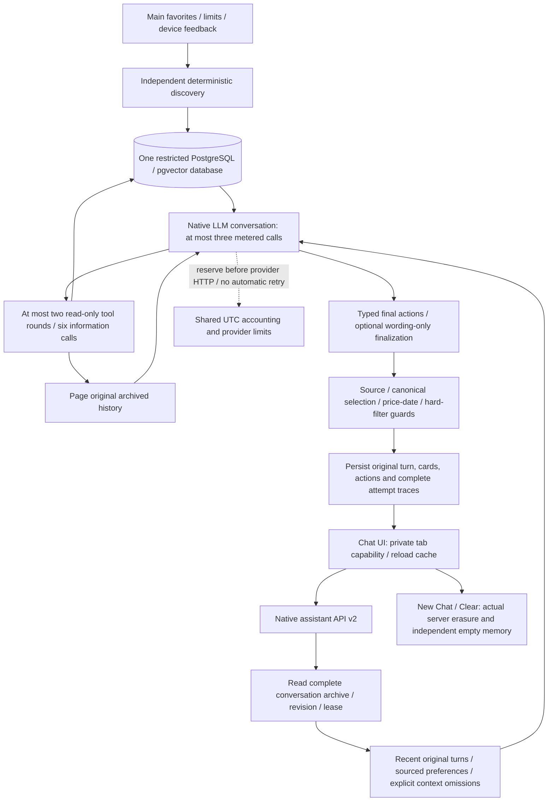
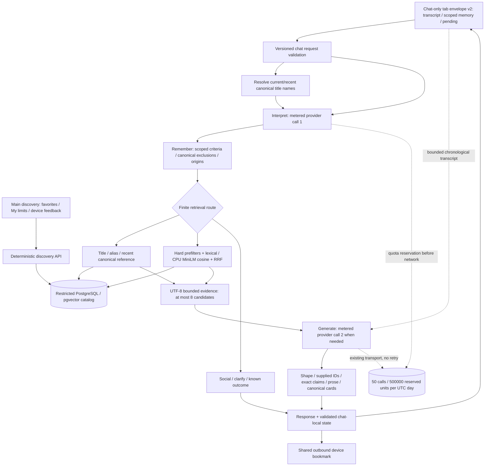
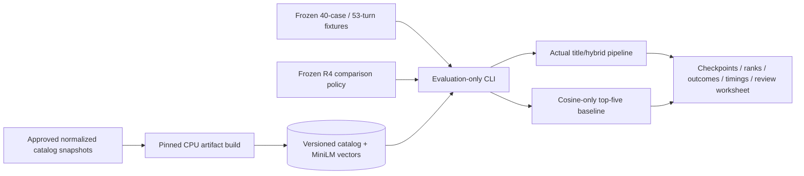

# Independent assistant — architecture and evaluation boundary

> **Current roadmap — 2026-11-04:** [catalog expansion → catalog-connected dashboard → publication/deployment](project-completion-plan.md). This document describes existing assistant architecture and dated revisions, not additional remaining implementation/evaluation tasks. Preserve independent chat and its bounded tools/archive; account for expanded-catalog title/retrieval limits and hosted model artifacts within the three tasks. Historical failures and unmeasured quality remain limitations, never invented passes.

## Current — simplified conversation engine, November 3

The owner approved replacing the patch/review cycle with the [simpler implementation and finite verification plan](reports/assistant-simplification-2026-11-03.md). One `DialogueAnswer` contract is parsed and validated before atomic persistence. Plain conversation is wrapped locally without a formatting call or guessed memory edits. Catalog replies have no automatic critique, rewrite or validation-repair call; invalid answers fail without saving changes. The ceiling remains three model calls/two information rounds/six tool calls, with no HTTP retries.

`recommend_games.excluded_titles` resolves up to eight names through the existing title resolver before retrieval. Ambiguity or unavailable lookup blocks that search rather than guessing. Temporary exclusions do not overwrite normal requirements. Recommendation evidence includes genres and sentence-bounded description excerpts up to 240 characters; insufficient text remains available through `game_details`.

UI/public wire, catalog ranking, archive/privacy/erasure, model, dependencies, database and quotas are unchanged. Current checks verify mechanics, not live semantic quality. The versioned v47/earlier journals remain immutable and cannot resume against changed source. The dated review/formatting descriptions below are historical.

## Current v47 — private lookup/critique contract

[Current evidence and limitations](reports/assistant-discovery-resume-2026-11-03.md). Literal native lookup is now `lookup_titles`, distinct from semantic/filter-aware `recommend_games`; lookup readiness alone cannot automatically disable another planning round. The existing spare reviewer receives candidate text/citations and returns private `unsupported_claims` plus corrected parts/cards; traces retain critique, public wire omits it. Successful catalog reads also trigger spare review when the answer omitted citations. Recommendation packets include explicit free-to-play flags. Same three-call ceiling, no classifier, HTTP retry, service/model/dependency/public-wire change. Current live evidence still fails recommendation completion/semantic grounding in some cases; a critique schema does not guarantee entailment. Do not claim acceptance from mechanical checks.

## Current v45 — evidence-aware spare-call audit

[Current evidence](reports/assistant-discovery-contract-2026-11-02.md). Required native semantic query/filter inputs remain locally validated. The existing review receives current candidate text as explicitly untrusted data and audits assertions against actual field evidence; typed actions/card eligibility stay retained. Ready-writer game replies also use this audit when a slot remains, so some replies now consume3calls instead of2, never exceeding the existing ceiling. Known parenthetical citation metadata is removed by rendering, with original model text retained in traces. No input classifier, new model/service/dependency or public API change. Broader live quality remains incomplete; static/offline checks are not semantic acceptance.

## Current v40 — native answer preservation

[Current implementation/evidence](reports/assistant-answer-preservation-2026-11-02.md). Native tools are optional for conversation; no classifier was added. Plain native prose is preserved by a dynamic text enum plus local validation during schema formatting; formatting cannot invent a stale card selection without current discovery. Only the current user request remains an instruction in the final writer, while older user originals remain sourced context/history/archive. Existing evidence/card/filter/atomic guards and3call ceiling remain. Scoped live answer-preservation passed; broader evaluation remains incomplete and paused at provider-planning headroom.

## Current v36 — one native requirements decision

[Implementation/evidence](reports/assistant-scope-fix-2026-11-01.md). `recommend_games` now requires `requirements_action`: use existing saved filters, apply a temporary override, or propose explicitly saved normal changes. Reads do not commit. The typed proposal is retained through final-answer validation rather than asking the writer to choose scope again; writer memory updates remain available. Saved-mode overrides receive correction feedback. Refused pages roll back pending proposals/applied filters. Non-search corrections retain their existing typed preferences channel. No input classifier, game-specific routing, new stage/service/dependency/model or public API change. Live budget save→temporary→restored passed independent record checks; remaining live gates are paused at provider planning headroom, not accepted.

## Current v28 projection and acceptance boundary — 2026-10-31

[Current evidence and exact continuation](reports/assistant-closeout-resume-2026-10-31-v28.md). The native architecture below remains: original server archive, model-selected read-only tools, typed atomic edits and canonical guards. Information tools explicitly declare batch readiness. Final writing uses original user messages and supplied field evidence while omitting earlier generated prose; a compact grounding review retains validated actions/selected cards within the same3call ceiling. Original messages/cards/evidence remain archived, never rewritten by working-context projection. A bounded complete page can end tool use early if the larger planning transcript cannot fit. No classifier/game-specific input routing, new service/model/dependency or public-wire change.

278backend/static checks and current actual UI integration pass; current v28live turns0. Earlier v27proved newly eligible temporary prices/retained normal budget but omitted the restored search, so its full capability gate failed. No broad grounding/naturalness/relevance/performance acceptance. Application52/100calls still has headroom; conservative owned-provider token planning pauses inference independently. Earlier version/count/next-command paragraphs below are historical.

## Current native flow and evidence — 2026-10-30 18:06UTC

[Owner-authorized closeout](reports/assistant-closeout-2026-10-30.md) · [Finite evaluation protocol](assistant-closeout-protocol.md). Generic v22 evidence-display/wording changes preserve the existing native architecture below.261backend/74frontend checks and current real archive/UI integration pass;40-request paired retrieval is measured, owner relevance pending, p952.364s misses1s target. No new live calls:98/100calls leaves onlytwo, so new versioned development waits for a fresh applicable receipt. Old completed v20/v21 journals are unchanged and cannot resume on new source. Final quality/publication acceptance remains incomplete.

Catalog tools never save normal filters; only final typed preference edits do. User-history citations are not game-fact evidence. Dated field evidence and deterministic price display do not establish arbitrary paraphrase entailment or live compatibility. Full originals remain archived within explicit storage ceilings; only working context is paged. New Chat/clear do not reset shared accounting. Canonical Save is outbound only, never a chat preference input. Normal50/500,000daily defaults remain, with approved temporary100/1.5M during evaluation.

**The dated verification paragraphs and classifier/Core/v1 diagram below are historical; the native flow above supersedes their serving/memory limits.**

**Latest verification — 2026-10-30 14:25UTC:** [Current-engine6/6v21 outcomes and accounting](reports/llm-first-resume-2026-10-30.md). No serving change. Original/corrected day, partner and unknown spending limit, early displayed pair, named catalog facts, non-game detour(no tools) and reference return all delivered. Independent API checks match prices, dates, modes, OS flags and descriptive claims. Nine positive current-engine replies acrossH20L/H21M/H21F have observedHTTPp957.382s(n9), not a broad latency/quality study. [Owner worksheet](reports/llm-first-owner-review-2026-10-30.md) is unscored; human/broader baseline acceptance remains incomplete. Allv20/v21paths finished, no replay. SQL98/1,118,299leaves2calls; no further worst-case turn today. Existing254backend/static/API checks apply to unchanged engine. Earlier06:54pending-v21 state is historical.

**Latest verification — 2026-10-30 06:54UTC:** [Current evidence and fresh v21 cases](reports/llm-first-resume-2026-10-30.md). No serving-source change. V20 delivered the full permanent15USD → temporary20USD → retained15USD sequence, with correct typed scopes and Windows/single-player retention. H20F final call hit actual provider429. All v20 case paths are now finished; five attempts/three deliveries/four dependent skips are not a full acceptance pass. Fresh v21 long-history/facts cases0/6use the same v20 engine and are prepared without inference. SQL86calls/974,396units; app14calls remain, independent provider headroom insufficient/unknown. Existing254backend/static/API checks apply to unchanged engine; new preparation helper's idempotency/no-overwrite/refusal and Ruff checks pass. Full semantic/naturalness/latency/owner acceptance remains incomplete. Earlier pending-v20 descriptions below are historical.

**Latest continuation — 2026-10-30:** [Current v20 evidence/architecture amendment](reports/llm-first-resume-2026-10-30.md). Catalog tools are READ ONLY: retrieval filters apply to that search, while a nonnullable final typed preference object is the sole requirement write. A validated plan's memory/preference metadata is held through a wording-only stage, avoiding silent loss during prose generation. Search supplies one explicit factual preview; arbitrary remaining fields/records stay tool-accessible. Rejected final envelopes pass the same local guards without another HTTP request. Numeric/ISO-date/identifier checks and price provenance strengthen output validation but do not prove arbitrary prose entailment. No input classifier/game-specific rules.254backend tests/Ruff/mypy30/OpenAPI pass. Current-source live delivery is blocked by actual provider429 at76/100application calls, not daily application exhaustion. Source-locked C: v20 has six unattempted held-out turns; latest quality/latency/human acceptance remains incomplete. Previous v13–v19 and historical R4 source checkpoints are not resumable on this source. Frontend/storage/model/config/limits unchanged.

**Current revision — 2026-10-29: LLM-first server-memory assistant, quality acceptance INCOMPLETE.** [Implementation/evidence/continuation](reports/llm-first-assistant-2026-10-29.md). Owner approved replacing the classifier-led flow and the former no-server-memory boundary. Current UI uses `/api/v2/assistant`: native optional catalog/history tools, no intent classifier, at most three model calls/two information rounds. PostgreSQL archives original turns, cards, changes and attempts behind a hashed guest capability. Typed retained filters, scoped source validation and paged context preserve the recommendation/card contracts. Old v1 remains compatible.244backend tests, mypy30/Ruff/contracts,72frontend tests plus5targeted recovery checks and19scratch SQL checks pass. Actual80-turn archive UI is read/axe-checked at1440/390/320 withzero inference. Earlier live failures remain; latest long-memory regression recallsTuesday→Thursday. Current fresh source-locked v3 evaluation is unattempted/paused at98calls/1,070,952units with onlytwo calls left. Semantic grounding/naturalness are NOT accepted by mechanical tests. Earlier diagrams/phase descriptions below are historical; frozenR4/v6 cannot resume on this source. No publication/M5.

**Current conversational serving — 2026-10-28:** [Context-aware follow-up revision](reports/chat-context-2026-10-28.md). Both LLM stages receive retained chronological chat messages within the existing byte cap; interpretation also receives canonical current/recent title names. Internal fact plans can inspect up to four games or a displayed subset. Serving validates LLM intent directly without the historical played/undo/genre keyword overrides. Public API/v2 memory contracts remain compatible.210backend tests and203actual-catalog/encoder scripted checks pass; live zombie → local co-op → other game's online co-op → original pair's couch play succeeds after a documented development correction. Frozen R4/v6 source and journals remain historical and cannot resume against this revision; no new quality/latency acceptance is claimed. The October26 keyword-routing description below is superseded for serving.

**Current quota operation — 2026-10-27:** [Temporary100/1,500,000allowance](reports/r4-quota-increase-2026-10-27.md) is applied with retained usage and normal50/500,000defaults. A separately documented operational wrapper invokes unchanged v6 code, preserving source hashes/output prefixes and observing provider limits without extra model calls/retries. C: journals remain authoritative with E: exports. Proposed development13/13passes; held-out pricing-prose failures and latency/human gates prevent acceptance. No new service/model/dependency/public wire.

**Current implementation — 2026-10-26:** [v6 checkpoint](reports/conversational-rag-r4-resume-2026-10-26.md). The interpretation stage now normalizes conservative explicit current-user played/undo operations before generic semantic validation; both comparison methods share it. Evaluation's authoritative pre-call journal lives in approved local C: storage with E: exports after each whole turn. Exact journal IO is separated from domain time; real quota SQL remains. Frozen public/domain schemas, ranking/model and main-data isolation remain. Full held-out live/human quality is pending.

**2026-10-25:** R0–R3 implemented locally; [R4 evaluation is incomplete](reports/conversational-rag-evaluation.md). Public hosting remains M2.

[Latest R4 fixes/checkpoint](reports/conversational-rag-r4-continuation.md): chat generation uses strict JSON Schema through the same metered transport, counting schema bytes inside the input bound. Backend canonical/claim/card validators remain. Read-only snapshots combine role/version/timeout metadata to reduce round trips. Source-frozen multi-day evaluation checkpoints pause before insufficient daily allowance; additional free-tier inference is approved. Human judgments and serving-only total latency remain separate acceptance evidence.

No arrow imports main discovery, saved lists or feedback into chat. No account, conversation database, vector service, agent fleet or hosted tracing. Existing30-second peer throttle, four calls/minute, single-slot concurrency,12,000input JSON bytes and two calls/turn remain. Validation failure preserves the prior state; it is not silently replaced by a successful fallback or extra generation.

### Reproducible offline side

Offline evaluation supplies oracle intent and scripted selection: it cannot measure live interpretation or generation. The approved live development pilot uses the same serving provider/accounting, with a persistent aggregate cap, never an unmetered client. Captured-output replay diagnoses failures without inference. See [evaluation report](reports/conversational-rag-evaluation.md) for the unresolved six-ID output failure and latency/quality gates. Local resource observations do not establish free hosted feasibility.
