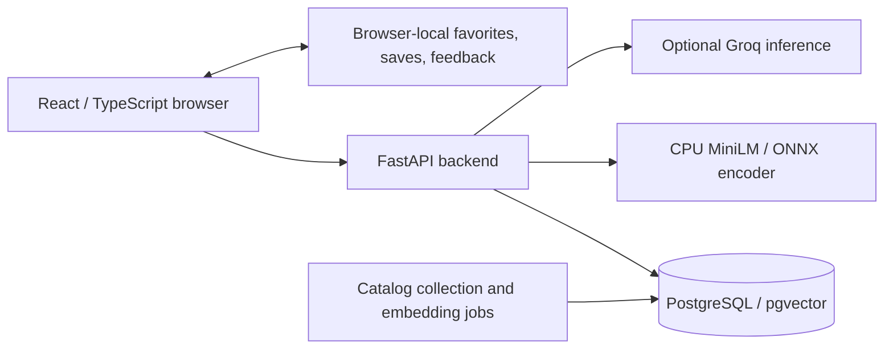

# Architecture

## Discovery and dashboard

The frontend submits favorites, explicit constraints, and relevant device feedback to the discovery API. The backend filters eligible games and ranks candidates using content embeddings and bounded feedback. Recommendations cite catalog fields and recorded US/USD prices; they do not require an LLM. The dashboard reads versioned analytics derived from the same active catalog.

## Independent assistant

The floating assistant uses its own conversation and filters, not the main discovery preferences. The backend grounds explicit game names against the active catalog and can use bounded title lookup, game details, hybrid lexical/semantic retrieval, and conversation-history tools. Typed validation and source/card checks run before committing a reply; they reduce errors but cannot guarantee the truth of every generated statement.

Conversation messages and displayed records are stored in a server-side archive protected by a private access capability held in the browser tab. New chat or clear-data actions request server-side erasure. Clearing browser storage directly removes the capability, not the archive, so erase the chat in the app first.

## Code map

- `frontend/src/`: React pages, charts, browser storage, and API clients.
- `backend/src/game_discovery/api/`: API routes and validation.
- `backend/src/game_discovery/catalog/` and `retrieval/`: catalog access, constraints, ranking, and embeddings.
- `backend/src/game_discovery/ai/`: provider transport, assistant dialogue, evidence, and archive.
- `backend/src/game_discovery/jobs/`: collection, indexing, and evaluation jobs.
- `backend/migrations/`, `backend/alembic/`: explicit database changes.

Model assets are pinned and hash-checked; generated weights and catalog snapshots are not committed. The [catalog guide](catalog.md) explains the version boundary.
