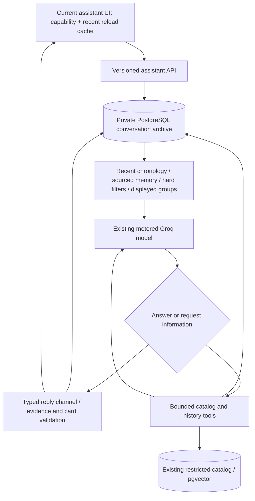

# LLM-first assistant revision — implementation and evaluation checkpoint

**Continuation superseded this checkpoint on2026-10-30:** [Current v20 source, actual provider pause and commands](llm-first-resume-2026-10-30.md). V13 was resumed and its failures preserved; it no longer matches current source. Do not run the v13 continuation command below against v20. This report remains dated October29 evidence.

**Status: implemented locally; conversational-quality acceptance INCOMPLETE.**

The owner approved an LLM-first assistant with bounded catalog tools, database-grounded game facts and complete conversation-scoped backend memory. Frontend skills were explicitly reconfirmed. This revision supersedes the prior prohibition on server-side chat storage. It does not authorize publication, commit/push, M5 or paid resources.

## Delivered architecture



### Conversation and tools

- New current UI uses **`POST /api/v2/assistant`**. The old `/api/v1/chat` wire remains compatible for older callers; its historical classifier-led path is not the new UI's conversation engine.
- `Dialogue` has **no intent classifier, genre/played/undo regex router, game-specific branch or intent-word blacklist**. The LLM chooses whether information is needed and writes the reply. Even a user explicitly requesting a literal word such as “social” is not blocked by a legacy category blacklist.
- At most **three model calls**, **two information rounds**, **four requested functions per round / six total**. Ordinary conversation can finish in one call. Tool argument feedback, structured finalization and grounding review all share that same ceiling. There are no automatic HTTP/provider retries.
- Native tools: `catalog_search`, `game_details`, `recommend_games`, `conversation_history`. The `json` function is the structured reply channel, not a catalog lookup or classifier. Its name accommodates the configured model's native reply behavior.
- Search is complete and paginated over **all catalog records**, with the actual query, total matching count, offset, next offset and scoped completeness. Exact-title matching never short-circuits a broader edition/title search. A search/shortlist does not establish franchise or worldwide completeness.
- Details can retrieve any known catalog ID, including records unsuitable for recommendations. All direct Game fields are listed; descriptions and large other values have explicit continuation cursors. Evidence values are preserved through lossless JSON pages, not silently omitted to save tokens.
- Recommendations reuse the existing semantic/lexical/RRF retrieval and hard predicates. Once a recommendation tool is used, older cached fact cards cannot bypass its filtered candidate set.
- Hard preferences are stored as typed server-side requirements. Omitted fields retain earlier conditions, explicit operations change them, grouped budget clears preserve consistency, and turn-only overrides do not overwrite conversation requirements. A correction can be acknowledged and persisted without a catalog call.
- Personal context and corrections have user-turn provenance. Original and changed memory values are indexed in their turn records, so a query using a memory key can find both versions. User-history citations are separate from game evidence and cannot alone authorize game cards.

### Grounding: implemented checks versus remaining acceptance

The backend validates canonical card IDs, recommendation eligibility/filters, known source IDs, user-turn origins, bounds and the reply schema. Final strict generation constrains card/source references to known identifiers. The final writer is explicitly told to remove unsupported assertions, distinguish missing support from absence and describe prices as dated records.

**A valid source ID is not a semantic proof that every free-form sentence follows from that source.** Earlier live runs demonstrated unsupported descriptive details and overconfident price wording even with valid cards. Grounding review and contract corrections address these issues, but broad factual entailment/naturalness are **not yet accepted**. Do not present the passing mechanical tests or an HTTP 200 delivery as a whole-conversation quality pass.

## Backend memory and guest isolation

- `discovery.conversation_archives` stores original user inputs, accepted replies, full displayed canonical cards, retrieved identities, sourced memory/preference changes and attempt/tool records. Input is committed before model work; failed/rate-limited attempts are retained. Interrupted leases cannot overwrite a later turn.
- Guest access uses a random per-chat capability, **SHA-256 hashed at rest**, transmitted in POST bodies rather than URLs. The model never receives this capability. Runtime access is execute-only through fixed-search-path functions; anonymous/authenticated browser roles have no function grants or table access. RLS has an explicit deny policy.
- Client-generated capabilities are saved before creation, making a lost creation response recoverable. Accepted turn IDs are idempotent: redisplaying/retrying a completed turn does not charge another model call.
- New chat explicitly erases the current server conversation, then begins with independent empty memory. Device clearing first attempts server erasure; a failure retains access and reports the problem instead of claiming successful erasure. Shared Save remains a device bookmark and is not imported into chat.
- The browser's version-3 cache is **not** the full archive. It contains the capability, revision, exact pending turn, draft and a bounded recent-message/card cache. Earlier originals are paged from the backend. Available v1/v2 tab messages/cards are imported with a truthful partial-history notice; text already lost by an older browser cache cannot be recovered retroactively.
- Working context remains within **12,000 UTF-8 input bytes per provider call**. It prioritizes retained requirements and exact displayed groups; omitted working data is explicitly marked and accessible through history tools. No original transcript is deleted during projection. Current UTC and original turn timestamps are available for temporal context.
- Free storage has explicit admission limits: **4 MiB per archive, 32 MiB shared logical document storage, 1,000 archives**, with bounded legacy bootstrap imports. At capacity, new turns stop; existing original history is not evicted. These are guest storage limits, not unlimited archival hosting.

## Database application and verification

- Added Alembic **0007 / SQL 0008** and **0008 / SQL 0009**; applied to the configured project, preserving catalog and accounting data. Current Alembic head is `0008`.
- [19 isolated scratch checks](llm-first-archive-scratch.json) pass with confirmed cleanup and zero inference/application-counter changes. They cover wrong capabilities, direct-table denial, empty new sessions, pending leases, interrupted/late completion, idempotency, retained attempts, erasure, larger complete bootstrap imports and explicit per-chat/shared capacity limits.
- Security advisor is clean. Performance advisor reported two pre-existing unused-index INFO notices (`job_runs_started_at_idx`, `games_search_idx`); they were not removed. [Advisor explanation](https://supabase.com/docs/guides/database/database-linter?lint=0005_unused_index).
- No auth service, new cloud service, dependency, embedding/model download, quota migration or environment-file edit was introduced.

## Engineering and browser checks

- **244 backend tests pass**, including new protocol, memory, history, pagination, source/card validation, filter correction, scope and isolation regressions. Ruff passes; strict mypy passes **30** configured source files.
- OpenAPI generation/check and generated TypeScript drift check pass. TypeScript and Vite production build pass through the existing source-matched C: dependency harness. The E: frontend dependency installation remains incomplete; this is not a fresh-install/remote-CI claim.
- [Full 72-test frontend run](llm-first-browser.json) passes. Historical legacy decoder tests remain; obsolete classifier-wire browser scenarios were replaced with server-memory integration tests. Original tests/source are preserved in the prechange archive.
- A subsequent concrete draft-loss issue was found in asynchronous history restoration. A functional state update now preserves a draft even after closing the panel, edits invalidate obsolete history reads, and failed history loads have a separate manual retry that does not call the model. [Five targeted recovery tests](llm-first-browser-recovery.json) pass after those fixes. This is not a claim of a new full 74-test run.
- Targeted ESLint passes with **zero warnings** when run from the actual E: frontend directory. An earlier C:-cwd lint invocation ignored external files and was not counted as a pass. Impeccable detector returned `[]` before the final nonvisual recovery fixes; CSS/layout did not change afterward.
- [Actual archive UI inspection](llm-first-archive-ui.json): browser → current API → restricted PostgreSQL restored the original and correction from the **80-turn synthetic checkpoint**, paged all earlier messages and rendered canonical expanded cards. At 1440/390/320: axe zero, no horizontal overflow or page errors, **zero generation requests**. All three retained captures were opened by the builder. No physical-phone or independent SHIP verdict is claimed.
- Inspection setup initially hit incomplete C: package entrypoints and one transient `database_unavailable` read. The helper was corrected to use installed entrypoints/context and await initial metadata. Runtime activity later showed two idle connections, not confirmed role exhaustion. No connection/quota settings or unrelated processes were changed. Successful manual history recovery clears its error.

## Live evidence — failures preserved

Authoritative journals are in **`C:/Users/User/AppData/Local/Temp/opencode/`**, outside the older R4 folder. [Export manifest and SHA-256 values](llm-first-evidence-manifest.json) identify byte-exact public snapshots. **Do not restore an E: export over C: or edit stored source identities.** `.private.json` files contain capabilities and must not be exported/committed.

| Evidence | Actual result and interpretation |
| --- | --- |
| Development v1–v5 / provider diagnostics | Preserved JSON-mode/native-tool incompatibility, malformed proposed calls and strict-schema failures. Not accepted conversations. |
| [Development v6 complete](llm-first-development-v6-complete.json) | 5/6 deliveries; plain conversational content outside the envelope was rejected. Original E: v6 checkpoint remains separate. |
| [Development v7](llm-first-development-v7.json) | 6/6 HTTP deliveries; IDs/technical wording remained. |
| [Held-out v7](llm-first-held-out-v7.json) | 8/12 deliveries; phase-transition throttle, bad filter arguments, reference routing, citation and unsupported-description issues retained. Not an acceptance pass. |
| [Development v8](llm-first-development-v8.json) | 5/6 deliveries; duplicated working evidence exhausted the request budget on a short follow-up. |
| [Development v9](llm-first-development-v9.json) | 6/6 deliveries after budget handling changes. Technical citation artifacts remained; not a general quality pass. |
| [Fresh held-out v10](llm-first-held-out-v10.json) | 1/3 attempted deliveries; history pagination/lookup and descriptive citation strings failed. Dependent turns remained skipped; not replayed in that experiment. |
| [Contract regression v11](llm-first-regression-v11.json) | Both HTTP 200, but the memory answer falsely said the original day was missing and the price wording was overconfident. **These are quality failures, not two passing cases.** |
| [Contract regression v12](llm-first-regression-v12.json) | Correct live recall: “We originally planned to play on Tuesday, but later changed the plan to Thursday.” Original and correction came from the persisted 80-turn prefix. Development regression only. |
| [Current held-out v13 checkpoint](llm-first-held-out-v13.json) | Source-locked fresh v3 cases prepared, **0/9 live turns attempted**, paused before any model reservation at insufficient worst-case call headroom. Current source matches this checkpoint. |

The 80-turn prefixes are **persisted synthetic conversations plus live recall probes**, not 80 live model turns. Human scores remain null. Evidence snapshots include all recorded failures; no historical R4 run was continued or rehashed.

Windows denied atomic replacement of the E: development-v6 journal. Its checkpoint was copied byte-exact to C: before resuming; the original copy hash was `c7fb6fc635926321eddbad31a3f7563535006b654ab3ceeda698021ae43f6746`. Later C: completion is exported under a different `-complete` name. This was an IO relocation, not an inference replay.

## Quota checkpoint and next continuation

Read-only receipt at **2026-10-29 21:37 UTC**: **98 application calls / 1,070,952 reserved units**, configured limits **100 / 1,500,000**. Two calls and 429,048 units remain. This is **insufficient to guarantee a three-call turn**, not a claim that the 100-call cap or Groq organization quota is already fully exhausted. Counter values/settings were not reset or raised. Ordinary defaults remain 50/500,000; the existing approved temporary runtime allowance remains unchanged.

Closing receipt at **22:20 UTC** confirmed the same98/1,070,952 values after the final build and archive UI checks. Those checks made no inference/reservations. The exported v13 checkpoint SHA-256 is `a33f290be39ba7c19c7624a0361e06f42c4f179f4faaa65b1496f5ecd04449e3`; the export helper reconfirmed that its stored source identity matches current source.

The runner reads a fresh effective receipt before each turn and respects a shared 61-second spacing sidecar. It stops on insufficient headroom or service-limit/infrastructure errors rather than repeatedly charging independent cases. Completed/failed records are never replayed by continuation. The next normal application UTC allowance begins **2026-10-30T00:00:00Z** on reservation, subject to independent provider windows and any other usage.

After a fresh applicable receipt, resume **only the prepared current experiment**, with unchanged source and model/limits:

```powershell
# Run from E:\Games-Recommendation-System\backend
.\.venv\Scripts\python.exe -m game_discovery.jobs.evaluate_dialogue_live --split held_out --cases "E:\Games-Recommendation-System\data\evaluation\dialogue-v3.json" --case-order U03 U02 U01 --max-new-turns 9 --output "C:\Users\User\AppData\Local\Temp\opencode\llm-first-held-out-v13.json"
```

No new inference approval or key is needed for this already-authorized free-tier continuation. If source/model/limits change, preserve the existing journal and start a documented new experiment; never replace its hashes. Do not resume old R4/v6 or earlier native experiments against current serving code.

**Remaining acceptance work:** finish fresh diverse conversations, inspect factual entailment and filter compliance, verify conversational repair/topic references with current source, and obtain actual owner judgments rather than inventing human ratings. Source-ID validation alone does not complete this gate.

## Preservation and local operation

Prechange implementation archive: `C:/Users/User/AppData/Local/Temp/opencode/llm-first-prechange-2026-10-28.zip`, SHA-256 `e20eb8f5a6a22554345b4945253c00d56c282f3b60728898fd4f40b5ce8c3b03`. Existing R0/R4 artifacts, journals, original hashes and earlier backups remain untouched.

Current local preview is **http://127.0.0.1:4173/** targeting API :8001. Refresh for the new bundle. Existing ignored configuration and cached encoder suffice. Services are left for inspection; verify actual listener/parent identities before stopping or duplicating them. Startup helper remains `C:/Users/User/AppData/Local/Temp/opencode/start-catalog-connection-recovery.py`.

Final identities checked: API launcher **26520**, serving child **11964** (:8001), preview **21900** (:4173). Current catalog status is ready with40games, semantic matching enabled and LLM configured. These are observed process identities, not permanent identifiers; recheck them before acting later.

No commit, push, hosted API/UI deployment, paid resource or M5 work. Hosted M2 is unchanged. This handoff is an implementation and honest evaluation checkpoint, **not a declaration that the three conversational requirements have all passed acceptance**.
